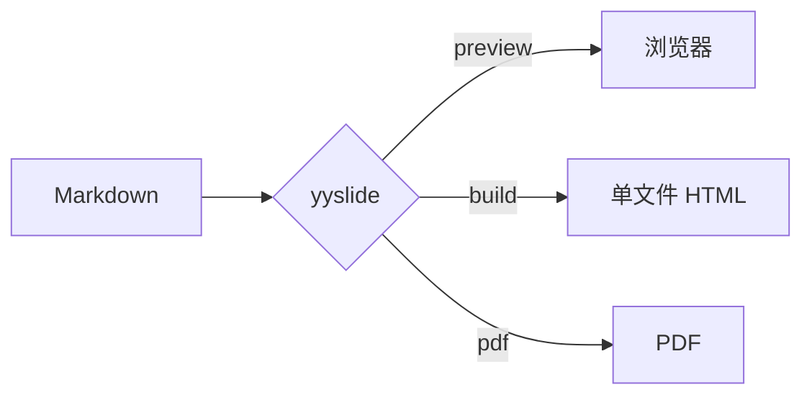

# JYY Slides Template

## 科大蓝 · Markdown · 离线播放

一份可直接复制修改的完整编写示例

> 内容写在 Markdown 中，样式集中在模板中，浏览器负责播放。

---

# 从 Markdown 开始

每页建议以一级标题 `#` 开头，它会自动成为顶部标题栏。第一页自动使用封面版式，其他版式见后面的“页面版式”。

使用**单独一行** `---` 分隔页面：

```markdown
# 第一页标题

第一页正文。

---

# 第二页标题

第二页正文。
```

1. 运行 `yyslide new my-talk` 创建工程。
2. 在 `my-talk/slides.md` 中分页并填写内容。
3. 运行 `yyslide preview`，边写边看，保存后自动刷新。
4. 运行 `yyslide build` 或 `yyslide pdf` 生成成品。

---

# 文字、列表与引用

## 常用 Markdown 排版

支持 **粗体**、==醒目标记==、*斜体*、~~删除线~~、`行内代码` 和 [链接](https://github.com/yaoyhu/yyslide)。

- 无序列表适合并列要点
- 每页建议突出一个核心主题
- 内容过多时优先拆成多页

> 引用块适合放置结论、核心观点或补充说明。

| Markdown 写法 | 显示效果 |
| --- | --- |
| `**重点**` | **重点** |
| `==警示==` | ==警示== |
| `*强调*` | *强调* |
| `` `code` `` | `code` |

---

# 代码高亮

在 fenced code block 后标注语言名称，浏览器会使用 highlight.js 自动高亮。

```python
from pathlib import Path


def build_slides(source: str) -> Path:
    source_path = Path(source)
    output_path = source_path.with_suffix(".html")
    print(f"构建 {source_path} → {output_path}")
    return output_path
```

支持 Python、JavaScript、C/C++、Java、Go、Rust 等常见语言。

---

# 数学公式

使用 `$...$` 编写行内公式，例如质能方程 $E = mc^2$。需要显示美元符号时写 `\$`，例如 \$100。

使用 `$$...$$` 编写独立公式：

$$\int_0^\infty e^{-x^2}\,dx = \frac{\sqrt{\pi}}{2}$$

矩阵和多行推导也可以直接使用 TeX：

$$
\begin{aligned}
f'(x) &= \lim_{h \to 0}\frac{f(x+h)-f(x)}{h} \\
\nabla \cdot \mathbf{E} &= \frac{\rho}{\varepsilon_0}
\end{aligned}
$$

公式由本地 MathJax 渲染，离线打开也能正常显示。

---

# Mermaid 图表

在 fenced code block 后标注 `mermaid`，就能把文字画成图，配色自动跟随主题：

````markdown

````


还支持时序图、类图、状态图、ER 图、甘特图和饼图等，语法错误会以红字显示在图的位置。

---

# 表格与任务列表

## 表格

| 内容 | 推荐写法 | 运行期依赖 |
| --- | --- | --- |
| 普通排版 | Markdown | 浏览器 |
| 代码 | 带语言名称的代码块 | highlight.js |
| 数学公式 | TeX | MathJax |
| 图表 | Mermaid 代码块 | Pele |
| 特殊布局 | 原生 HTML + CSS | 浏览器 |

## 任务列表

- [x] 安装构建依赖
- [x] 编写 Markdown
- [ ] 构建 HTML
- [ ] 全屏检查实际效果

---

# 脚注

正文中用 `[^名称]` 标注引用[^tex]，在同一页任意位置写定义，序号每页从 1 开始。

```markdown
正文中标注引用[^tex]。

[^tex]: 引用内容，可以包含 **粗体**、`代码`、$x^2$ 和链接。
```

脚注会自动显示在页面底部，上方带一条分隔线[^fit]。

[^tex]: Knuth, D. E. *The TeXbook*. Addison-Wesley, 1984.
[^fit]: 脚注不随正文缩放，正文内容过多时会为它让出空间。

---

# 插入图片

先将图片放入工程的 `images/` 目录，再使用相对路径：

```markdown

```


图片路径相对于 **Markdown 文件**，构建时会自动打包进 HTML。模板会限制图片宽高，并随正文一起自动缩放。

---

<!-- section -->
# 页面版式

## 这一页就是节标题：开头写 `<!-- section -->`

---

<!-- image-right -->
# 图片与标题

开头写 `<!-- image-right -->`，标题和文字留在左栏，正文里的图片自动移到右侧。

- 图片完整显示，不裁剪
- 写 `<!-- image-right crop -->` 时，图片铺满右栏，并居中裁掉超出部分，适合白边很大的图


---

<!-- two-cols -->
# 两栏内容

## 左栏

开头写 `<!-- two-cols -->`，单独一行 `::col::` 分隔各栏。

::col::


---

<!-- compare -->
# 比较

## 普通页

- 一个标题
- 一栏内容

::col::

## compare

- 栏首小标题成为表头
- 适合方案对比

---

<!-- figure -->
# 标题写结论，图片作证据


---

<!-- results -->
# 结果表 + 结论

| 方法 | 指标 A | 指标 B |
| --- | --- | --- |
| **首列加粗的行会高亮** | [值] | [值] |
| 基线 | [值] | [值] |

> 引用块显示为结论条。

---

<!-- statement -->
# 一句话观点

一级标题写观点，这里写补充说明。

---

<!-- quote -->
> 引用块放大显示，适合一句原话或论文结论。

后面的段落作为出处

---

<!-- fact -->
# [数字]

一级标题写数字，这里写指标和对比基线。

---

# 版式一览

| 标记 | 版式 |
| --- | --- |
| `cover` `section` | 标题幻灯片、节标题 |
| `two-cols` `three-cols` `compare` | 两栏、三栏、比较，用 `::col::` 分栏 |
| `image-right` `image-left` `full` | 图文并排、全屏图，可加 `crop` 裁剪 |
| `figure` `results` | 结论 + 大图、结果表 + 结论 |
| `statement` `fact` `quote` | 一句话观点、大数字、引用 |
| `agenda` `end` | 自动目录（列出 section 页）、总结 |

标记写在一页的最开头，例如 `<!-- two-cols -->`。

---

# 原生 HTML 增强

需要控制图片宽度或实现特殊布局时，可以在 Markdown 中直接写 HTML：

```html

```

<div style="display: grid; grid-template-columns: 1fr 1fr; gap: 1.2em; margin-top: .8em;">
  <div style="padding: .8em 1em; background: #f5f8fc; border-left: 4px solid #004098;">
    <strong>常规内容</strong><br>优先使用 Markdown，保持源文件简洁。
  </div>
  <div style="padding: .8em 1em; background: #f5f8fc; border-left: 4px solid #004098;">
    <strong>特殊布局</strong><br>少量使用 HTML，通用样式放进模板。
  </div>
</div>

---

# 构建、播放与检查

```bash
yyslide preview   # 实时预览
yyslide build     # → dist/<名称>.html
yyslide pdf       # → dist/<名称>.pdf
```

| 操作 | 按键 |
| --- | --- |
| 下一页 | `Space`、`→`、`↓`、`Enter` |
| 上一页 | `←`、`↑`、`Backspace` |
| 首页 / 末页 | `Home` / `End` |
| 进入 / 退出全屏 | `f` |

- 预览时保存即刷新，并停留在当前页。
- 页面会自动缩小溢出的正文，但内容过多时仍建议拆页。
- `dist/` 下的 HTML 已内联字体、公式库和图片，单个文件即可分享。
